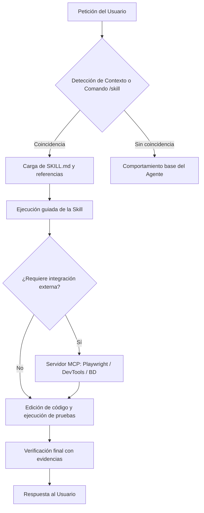

# ricra-skills

Colección modular de **skills en español** para agentes de código e inteligencia artificial (OpenCode, Claude Code, Cursor, Windsurf, Antigravity, GitHub Copilot y compatibles) junto con configuración de servidores **MCP** (Model Context Protocol).

---

## Índice

- [Resumen del Proyecto](#resumen-del-proyecto)
- [Compatibilidad con Agentes](#compatibilidad-con-agentes)
- [Catálogo de Skills (26)](#catálogo-de-skills-26)
  - [Diseño Visual, UI/UX y Frontend](#diseño-visual-uiux-y-frontend)
  - [Backend y Bases de Datos](#backend-y-bases-de-datos)
  - [Testing, QA y Calidad](#testing-qa-y-calidad)
  - [Seguridad y Flujo Git](#seguridad-y-flujo-git)
  - [Auditoría y Arquitectura](#auditoría-y-arquitectura)
  - [Herramientas de Ecosistema y Productividad](#herramientas-de-ecosistema-y-productividad)
- [Arquitectura y Funcionamiento](#arquitectura-y-funcionamiento)
- [Estructura del Repositorio](#estructura-del-repositorio)
- [Servidores MCP (`opencode.json`)](#servidores-mcp-opencodejson)
- [Instalación y Configuración](#instalación-y-configuración)
  - [1. Instalación Global de Skills (Recomendada)](#1-instalación-global-de-skills-recomendada)
  - [2. Instalación por Proyecto](#2-instalación-por-proyecto)
  - [3. Configuración de Servidores MCP](#3-configuración-de-servidores-mcp)
- [Seguridad y Auditoría de Secretos](#seguridad-y-auditoría-de-secretos)
- [Licencia](#licencia)

---

## Resumen del Proyecto

**ricra-skills** reúne directivas operativas, patrones de arquitectura, listas de verificación y bases de conocimiento empaquetadas bajo el estándar de **Agent Skills** (`SKILL.md` con metadatos YAML).

A diferencia de los prompts genéricos, cada skill:
1. Se activa únicamente cuando la tarea coincide con su dominio (por contexto o invocación directa con `/nombre-skill`).
2. Proporciona instrucciones deterministas paso a paso, árboles de decisión y referencias técnicas detalladas sin sobrecargar innecesariamente el contexto base del modelo.
3. Está completamente redactada en **español técnico**, con terminología precisa de la industria.

---

## Compatibilidad con Agentes

Las skills de este repositorio son compatibles con cualquier entorno o agente que reconozca el formato `SKILL.md` o cargue carpetas de instrucciones:

| Herramienta / Agente | Soporte de Skills | Soporte MCP |
|---|---|---|
| **OpenCode** | Nativo (`~/.agents/skills` o `.agents/skills`) | Nativo (`opencode.json` en `~/.config/opencode/`) |
| **Claude Code / Desktop** | Nativo (`~/.agents/skills` o prompts de sistema) | Nativo (`claude_desktop_config.json`) |
| **Antigravity / Gemini CLI** | Nativo (`~/.agents/skills`) | Nativo vía configuración de plugins/MCP |
| **Cursor / Windsurf** | Vía carpetas de reglas/skills de usuario (`.cursorrules` / `.agents`) | Nativo (MCP integrado en configuración) |
| **Roo Code / Cline** | Compatible (prompts y carpetas de configuración) | Nativo (Settings MCP) |
| **GitHub Copilot CLI** | Compatible vía referencias en `.github/copilot-instructions.md` | En evolución |

---

## Catálogo de Skills (26)

### Diseño Visual, UI/UX y Frontend

| Skill | Descripción y Casos de Uso |
|---|---|
| [`design-ricra`](skills/design-ricra/SKILL.md) | Sistema de diseño Tea Green: tipografía, paleta, temas claro/oscuro, tokens CSS y contraste. |
| [`ui-ux-pro-max`](skills/ui-ux-pro-max/SKILL.md) | Inteligencia UI/UX integral: 50+ estilos visuales, 192 paletas razonadas, 74 parejas tipográficas, 119 reglas UX, presets GSAP y stacks soportados. |
| [`diseno-apple`](skills/diseno-apple/SKILL.md) | Principios de diseño visual y motion físico estilo Apple: springs, sheets, translucidez y jerarquía. |
| [`diseno-frontend`](skills/diseno-frontend/SKILL.md) | Dirección de arte intencional para interfaces web distintivas, evitando plantillas genéricas. |
| [`mejorar-diseno-existente`](skills/mejorar-diseno-existente/SKILL.md) | Diagnóstico visual y elevación estética de sitios y aplicaciones en producción sin romper funcionalidad. |
| [`desarrollador-angular`](skills/desarrollador-angular/SKILL.md) | Arquitectura y desarrollo moderno en Angular: Signals, componentes Standalone, formularios reactivos, SSR, accesibilidad ARIA y testing. |

### Backend y Bases de Datos

| Skill | Descripción y Casos de Uso |
|---|---|
| [`patrones-backend-nodejs`](skills/patrones-backend-nodejs/SKILL.md) | Servicios de producción en Node.js con Express/Fastify: middlewares, manejo tipado de errores, autenticación y diseño de APIs REST/GraphQL. |
| [`java-springboot`](skills/java-springboot/SKILL.md) | Buenas prácticas, estructura por capas y arquitectura por dominio para proyectos con Spring Boot. |
| [`optimizacion-sql`](skills/optimizacion-sql/SKILL.md) | Optimización universal de consultas SQL (PostgreSQL, MySQL, SQL Server, Oracle): planes de ejecución `EXPLAIN`, indexación, particionado y paginación eficiente. |

### Testing, QA y Calidad

| Skill | Descripción y Casos de Uso |
|---|---|
| [`tdd`](skills/tdd/SKILL.md) | Desarrollo guiado por pruebas (ciclo Red-Green-Refactor) orientado a pruebas de comportamiento por interfaces públicas. |
| [`pruebas-jest`](skills/pruebas-jest/SKILL.md) | Patrones, estructuras y estrategias de mocks para pruebas unitarias e integración en TypeScript/JavaScript con Jest. |
| [`pruebas-springboot`](skills/pruebas-springboot/SKILL.md) | Especialista en testing para Spring Boot 4: JUnit 6, AssertJ, Instancio, `@WebMvcTest` y Testcontainers. |
| [`buenas-practicas-playwright`](skills/buenas-practicas-playwright/SKILL.md) | Pruebas E2E, componentes, accesibilidad y API con Playwright: Page Object Model (POM), manejo de tests inestables (*flaky*), autenticación y CI/CD. |
| [`plan-pruebas-pymes`](skills/plan-pruebas-pymes/SKILL.md) | Elaboración pragmática de planes de pruebas para proyectos y pequeñas empresas: casos concretos respaldados por evidencias. |
| [`verificacion-final`](skills/verificacion-final/SKILL.md) | Verificación obligatoria con ejecución de comandos y confirmación de evidencias antes de marcar tareas como completadas. |

### Seguridad y Flujo Git

| Skill | Descripción y Casos de Uso |
|---|---|
| [`seguridad-y-blindaje`](skills/seguridad-y-blindaje/SKILL.md) | Blindaje de código contra vulnerabilidades OWASP Top 10: sanitización de entradas, control de sesiones, autenticación y análisis de dependencias. |
| [`despliegue-seguro`](skills/despliegue-seguro/SKILL.md) | Protocolo de despliegue amplio: preparación de hooks pre-commit, barreras git, validaciones automáticas y commits estructurados. |
| [`commit-rapido`](skills/commit-rapido/SKILL.md) | Commits ágiles del día a día: mensajes concisos en español con validación mínima de seguridad. |

### Auditoría y Arquitectura

| Skill | Descripción y Casos de Uso |
|---|---|
| [`auditoria-codigo`](skills/auditoria-codigo/SKILL.md) | Auditoría estática de código de solo lectura: detección de código espagueti, deuda técnica y reporte detallado con `archivo:línea`. |
| [`auditoria-sitio-web`](skills/auditoria-sitio-web/SKILL.md) | Auditoría de sitios web con CLI de `squirrelscan` (SEO, performance, seguridad, a11y, 260+ reglas) y ciclo iterativo de corrección. |
| [`diagnosticar-errores`](skills/diagnosticar-errores/SKILL.md) | Bucle de diagnóstico para bugs complejos y regresiones de rendimiento, incluyendo sanitización de datos confidenciales. |
| [`diseno-modulos`](skills/diseno-modulos/SKILL.md) | Vocabulario y técnicas para el diseño de módulos profundos: interfaces pequeñas, implementaciones ricas y alta testabilidad. |
| [`generador-arquitectura`](skills/generador-arquitectura/SKILL.md) | Análisis del código fuente para generar documentación técnica, diagramas C4/UML y registros de decisiones arquitectónicas (ADRs). |
| [`generador-readme`](skills/generador-readme/SKILL.md) | Generador completo y fáctico de archivos `README.md` basado en la inspección real del repositorio. |

### Herramientas de Ecosistema y Productividad

| Skill | Descripción y Casos de Uso |
|---|---|
| [`convertir-documentos-markdown`](skills/convertir-documentos-markdown/SKILL.md) | Conversión de documentos Word (.docx), PowerPoint (.pptx), Excel (.xlsx), PDF, OpenDocument, EPUB y CSV a Markdown. |
| [`buscar-habilidades`](skills/buscar-habilidades/SKILL.md) | Descubrimiento e instalación de skills disponibles en el ecosistema abierto de agentes. |

---

## Arquitectura y Funcionamiento

Cada skill opera como un módulo autocontenido que el agente activa bajo demanda:



---

## Estructura del Repositorio

```text
ricra-skills/
├── .gitignore                     # Filtros para cachés, dependencias y credenciales locales
├── README.md                      # Documentación central del proyecto
├── opencode.json                  # Manifiesto de 5 servidores MCP para agentes
└── skills/                        # 26 skills modulares
    ├── auditoria-codigo/          # Auditoría estática y detección de malas prácticas
    ├── auditoria-sitio-web/       # Auditoría integral web (assets, referencias y SKILL.md)
    ├── buenas-practicas-playwright/ # Playwright (arquitectura, POM, auth, CI/CD)
    ├── buscar-habilidades/        # Instalador y descubridor de skills
    ├── commit-rapido/             # Mensajes de commit concisos en español
    ├── convertir-documentos-markdown/ # Conversor multiformato a Markdown
    ├── desarrollador-angular/     # Guías completas Angular (Signals, Forms, SSR)
    ├── design-ricra/              # Tokens y sistema de diseño Tea Green
    ├── despliegue-seguro/         # Flujo de verificación previa y despliegue
    ├── diagnosticar-errores/      # Bucle sistemático de resolución de bugs
    ├── diseno-apple/              # Principios de interacción y diseño Apple
    ├── diseno-frontend/           # Dirección de diseño web distintivo
    ├── diseno-modulos/            # Principios de diseño de módulos profundos
    ├── generador-arquitectura/    # Generación de planos C4 y arquitectura
    ├── generador-readme/          # Generador fáctico de documentación README
    ├── java-springboot/           # Guías de desarrollo en Spring Boot
    ├── mejorar-diseno-existente/  # Técnicas de rediseño sin roturas
    ├── optimizacion-sql/          # Análisis y optimización SQL multibase
    ├── patrones-backend-nodejs/   # Arquitectura backend robusta en Node.js
    ├── plan-pruebas-pymes/        # Planes de prueba prácticos
    ├── pruebas-jest/              # Testing con Jest y mocks limpios
    ├── pruebas-springboot/        # Testing exhaustivo Spring Boot 4
    ├── seguridad-y-blindaje/      # Hardening contra OWASP Top 10
    ├── tdd/                       # Metodología Red-Green-Refactor
    ├── ui-ux-pro-max/             # Base de datos y scripts de inteligencia UI/UX
    └── verificacion-final/        # Protocolo de evidencias antes del cierre
```

---

## Servidores MCP (`opencode.json`)

El archivo [`opencode.json`](opencode.json) declara 5 servidores que extienden las capacidades del agente sin requerir claves de API privadas:

| Servidor | Tipo | Comando / URL | Utilidad |
|---|---|---|---|
| `brave-devtools` | Local | `npx -y brave-mcp@latest` | Inspección y automatización en Brave Browser. |
| `context7` | Remoto | `https://mcp.context7.com/mcp` | Documentación técnica y contexto de librerías actualizado. |
| `playwright` | Local | `npx -y @playwright/mcp@latest` | Navegación autónoma, pruebas E2E e interacción con DOM. |
| `dbhub` | Local | `npx -y @bytebase/dbhub@latest --transport stdio --demo` | Exploración de esquemas y consultas en bases de datos. |
| `chrome-devtools` | Local | `npx -y chrome-devtools-mcp@latest` | Diagnóstico de consola, accesibilidad, rendimiento y red en Chrome. |

---

## Instalación y Configuración

### 1. Instalación Global de Skills (Recomendada)

Permite que cualquier agente o CLI en tu equipo disponga de todas las skills:

```bash
# 1. Clonar el repositorio
git clone https://github.com/TeVerde29/ricra-skills.git

# 2. Copiar las skills al directorio global de agentes
# En Linux / macOS:
mkdir -p ~/.agents/skills
cp -r ricra-skills/skills/* ~/.agents/skills/

# En Windows (PowerShell):
New-Item -ItemType Directory -Force -Path "$HOME\.agents\skills"
Copy-Item -Recurse -Force "ricra-skills\skills\*" "$HOME\.agents\skills\"
```

*(Si solo deseas algunas skills concretas, copia únicamente las carpetas deseadas, por ejemplo `tdd`, `seguridad-y-blindaje` o `generador-readme`).*

### 2. Instalación por Proyecto

Si deseas incluir las skills únicamente en un proyecto específico para que todo el equipo las comparta:

```bash
# Dentro de la raíz de tu proyecto
mkdir -p .agents/skills
cp -r /ruta/a/ricra-skills/skills/tdd .agents/skills/
cp -r /ruta/a/ricra-skills/skills/verificacion-final .agents/skills/
```

### 3. Configuración de Servidores MCP

#### Para OpenCode
Copia el manifiesto a tu configuración de usuario:

```bash
# Linux / macOS:
cp ricra-skills/opencode.json ~/.config/opencode/opencode.json

# Windows (PowerShell):
Copy-Item "ricra-skills\opencode.json" "$HOME\.config\opencode\opencode.json"
```

#### Para Claude Desktop / Cursor / Antigravity
Puedes trasladar los servidores declarados en `opencode.json` al archivo de configuración correspondiente (por ejemplo en Claude Desktop: `%APPDATA%\Claude\claude_desktop_config.json` en Windows o `~/Library/Application Support/Claude/claude_desktop_config.json` en macOS) mapeando las entradas bajo la clave `"mcpServers"`.

---

## Seguridad y Auditoría de Secretos

El repositorio no almacena credenciales, tokens ni variables de entorno. Puedes auditar el código localmente antes de desplegar o sincronizar:

```powershell
# Búsqueda estricta de patrones de secretos en el repositorio
Select-String -Recurse -Path skills,opencode.json -Pattern 'sk-[A-Za-z0-9]|ghp_|xoxb|AKIA|password\s*[:=]\s*[''"][^''"]+[''"]' | Select-Object Path,LineNumber,Line
```

El resultado debe ser estrictamente cero coincidencias reales (las únicas apariciones son nombres de variables de ejemplo en guías teóricas).

---

## Licencia

Distribuido para uso en desarrollo de agentes de software. Cada skill contiene instrucciones de acceso público para optimizar flujos de trabajo de ingeniería.
